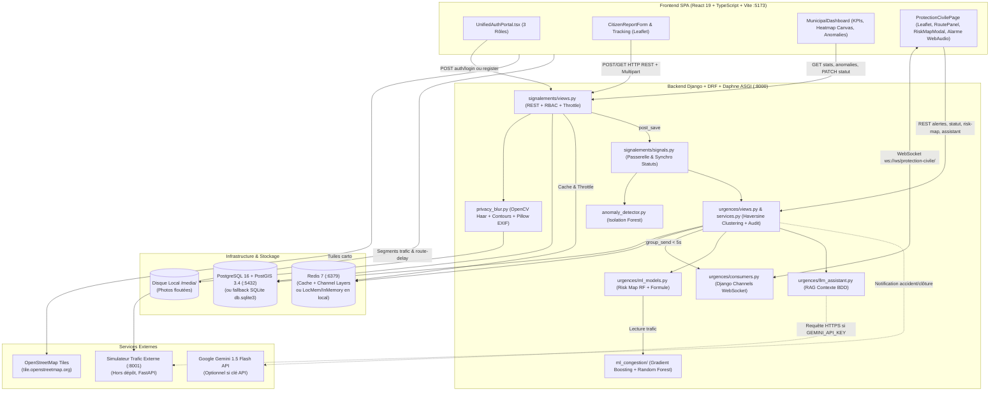

# Audit Technique Exhaustif — SmartCity Insight AI

> **Portée de l'audit :** Analyse 100 % factuelle basée exclusivement sur le code source réel présent dans le dépôt `smartcity-insight-ai` (Nord-Est du Cap Bon : Kélibia, Hammam El Ghezaz, El Haouaria, Dar Allouche, Kerkouane, Azmour, Menzel Horr).  
> **Légende des statuts de conformité :**
> - **Complet (Fait)** : Exigence implémentée fonctionnellement de bout en bout conformément au cahier des charges.
> - **Partiel** : Exigence partiellement implémentée (composants manquants, logique simplifiée ou non connectée de bout en bout).
> - **Adapté** : Exigence satisfaite via une technologie ou approche différente de celle initialement spécifiée (ex. Leaflet + simulateur externe à la place de Google Maps/Routes API, Haversine Python à la place de PostGIS natif).
> - **Absent (Manquant)** : Fonctionnalité ou brique technique non présente dans le dépôt.

---

## 1. Vue d'Ensemble, Architecture & Stack Réelle

### 1.1 Arborescence commentée du projet

```text
smartcity-insight-ai/
├── config/                                  # Noyau de configuration Django & routage ASGI/HTTP
│   ├── __init__.py
│   ├── asgi.py                              # Routeur ASGI (HTTP Django + WebSockets Channels)
│   ├── geo_config.py                        # Source unique de vérité géographique (Cap Bon NE, casernes, secteurs)
│   ├── settings.py                          # Configuration Django, DRF, Channels, Redis, PostGIS/SQLite, CORS
│   ├── urls.py                              # Routage REST centralisé (/api/signalements/, /api/urgences/, /api/ml/)
│   └── wsgi.py                              # Point d'entrée WSGI standard
├── signalements/                            # Module Étudiant 2 : Signalements, Floutage INPDP, Dashboard & Anomalies
│   ├── cascades/                            # Modèles XML Haar Cascade OpenCV embarqués
│   │   ├── haarcascade_frontalface_default.xml
│   │   └── haarcascade_russian_plate_number.xml
│   ├── management/commands/
│   │   └── init_demo_roles.py               # Commande CLI d'initialisation des comptes démo (mairie & citoyen)
│   ├── migrations/                          # 6 migrations Django (0001 à 0006)
│   ├── admin.py                             # Administration Django (ProfilUtilisateur, Signalement, AlerteAnomalie)
│   ├── anomaly_detector.py                  # Pipeline ML non supervisé Isolation Forest (pics spatio-temporels)
│   ├── apps.py                              # AppConfig enregistrant signalements.signals au démarrage
│   ├── authentication.py                    # Implémentation JWT HS256 sans dépendance externe (BearerJWTAuthentication)
│   ├── models.py                            # UserRole, ProfilUtilisateur, Signalement (auto-blur), AlerteAnomalie
│   ├── permissions.py                       # Permissions RBAC DRF (IsResponsableMunicipal, IsCitoyenOrReadOnly)
│   ├── privacy_blur.py                      # Anonymisation IA OpenCV + contours + purge EXIF Pillow
│   ├── serializers.py                       # Sérialiseurs DRF + masquage INPDP (IP/auteur) pour le public
│   ├── signals.py                           # Passerelle Citoyen -> Protection Civile & synchro bidirectionnelle des statuts
│   ├── tests.py                             # Suite de 15 tests (floutage, API, throttling, RBAC, synchro, analytics, ML)
│   ├── urls.py                              # Routes /api/signalements/ (auth, anomalies, ViewSet)
│   └── views.py                             # ViewSet, KPIs/agrégations PostGIS/SQLite, login/register, anomalies API
├── urgences/                                # Module Étudiant 3 : Temps Réel, Qualification, Risk Map & Assistant RAG
│   ├── management/commands/
│   │   └── simulate_urgences.py             # Commande CLI de scénarios démo jury
│   ├── migrations/                          # 2 migrations Django (0001 à 0002)
│   ├── admin.py                             # Vide (aucun modèle enregistré dans l'admin)
│   ├── apps.py                              # Configuration de l'application urgences
│   ├── consumers.py                         # Consumer WebSocket Channels (ProtectionCivileConsumer)
│   ├── llm_assistant.py                     # RAG temps réel + appel Gemini 1.5 Flash + fallback déterministe
│   ├── ml_models.py                         # Moteur Risk Map (formule composite + RandomForestClassifier)
│   ├── models.py                            # SignalementAccident, AlerteAccident, JournalAudit, JournalAuditIntervention
│   ├── services.py                          # Clustering spatial Haversine, machine d'état, diffusion WS non bloquante
│   ├── simulation.py                        # Scénarios de démonstration (fausse alerte, clustering, risk map)
│   ├── tests.py                             # Suite de 12 tests (clustering, workflow, audit, Risk Map, LLM, API)
│   └── views.py                             # Endpoints REST /api/urgences/* + notifications au simulateur (port 8001)
├── ml_congestion/                           # Module Étudiant 1 (partiel) : ML Prédiction de Congestion
│   ├── data/
│   │   └── traffic_historical_dataset.csv   # Dataset synthétique généré (17 280 lignes de données + 1 en-tête)
│   ├── models/
│   │   ├── best_congestion_classifier.joblib
│   │   └── best_congestion_regressor.joblib
│   ├── reports/
│   │   └── model_evaluation.json            # Rapport d'évaluation comparatif (Random Forest vs Gradient Boosting)
│   ├── api_views.py                         # Endpoints REST /api/ml/congestion/predict/ et /metrics/
│   ├── data_generator.py                    # Wrapper vers data_pipeline.build_chronological_dataset
│   ├── data_pipeline.py                     # Définition des 8 corridors Cap Bon & générateur chronologique
│   ├── predictor.py                         # Inférence congestion, delta impact chantier, recommandations délestage
│   ├── test_demo.py                         # Script CLI de démonstration du Module D
│   ├── tests.py                             # 5 tests unitaires et d'intégration API ML
│   └── train.py                             # Pipeline Scikit-learn (ColumnTransformer + RF vs GBoost)
├── frontend/                                # Application SPA React 19 + TypeScript + Vite
│   ├── dist/                                # Build de production déjà généré
│   ├── public/                              # Icônes statiques (favicon.svg, icons.svg)
│   ├── src/
│   │   ├── components/
│   │   │   ├── AlertsList.tsx               # File des alertes Protection Civile + transitions de statut
│   │   │   ├── CitizenLocationPickerMap.tsx # Sélecteur GPS interactif Leaflet (clic & drag)
│   │   │   ├── CitizenReportForm.tsx        # Formulaire citoyen (GPS, photo, rate limit, anti-doublon)
│   │   │   ├── CitizenTrackingView.tsx      # Carte publique & barre de progression 4 étapes
│   │   │   ├── GoogleMapComponent.tsx       # Carte tactique Leaflet (malgré son nom) + trafic + Risk Map + tracé
│   │   │   ├── Header.tsx                   # Barre supérieure Protection Civile (WS, sirène, trafic, Risk Map)
│   │   │   ├── MunicipalCharts.tsx          # 3 graphiques HTML/CSS/SVG sans librairie externe
│   │   │   ├── MunicipalDashboard.tsx       # Dashboard Responsable (KPIs, filtres, anomalies IA, file priorisée)
│   │   │   ├── MunicipalHeatmap.tsx         # Heatmap canvas 2D sur Leaflet + clusters + overlays
│   │   │   ├── MunicipalLogin.tsx           # Écran de connexion dédié fallback
│   │   │   ├── RiskMapModal.tsx             # Modale onglets Secteurs Risk Map & Chat Assistant RAG
│   │   │   ├── RoutePanel.tsx               # Panneau itinéraire secours, choix caserne & journal d'audit
│   │   │   └── UnifiedAuthPortal.tsx        # Portail d'entrée 3 rôles (Responsable, Citoyen, Protection Civile)
│   │   ├── config/geoConfig.ts              # Config géo par défaut & helpers Leaflet/OSM
│   │   ├── pages/ProtectionCivilePage.tsx   # Page commandement 3 colonnes + client WebSocket
│   │   ├── services/
│   │   │   ├── api.ts                       # Client Axios, intercepteur JWT, appels REST & simulateur (8001)
│   │   │   └── sound.ts                     # Synthèse sonore Web Audio API (sirène 880/660 Hz)
│   │   ├── App.tsx                          # Routage étanche par rôle connecté
│   │   ├── App.css                          # CSS template Vite résiduel
│   │   ├── index.css                        # Thème sombre Glassmorphism & styles Leaflet
│   │   ├── main.tsx                         # Point d'entrée React StrictMode
│   │   └── types.ts                         # Interfaces TypeScript complètes
│   ├── .env.example                         # Variables Vite (Google Maps key, URLs backend/WS/simulateur)
│   ├── .oxlintrc.json                       # Configuration linter Oxlint
│   ├── index.html                           # Page HTML hôte + CDN CSS Leaflet
│   ├── package.json                         # Dépendances Node/Vite
│   ├── tsconfig*.json                       # Configuration TypeScript
│   └── vite.config.ts                       # Serveur Vite (5173) + proxys /api, /media, /ws, /traffic-sim
├── media/signalements/anonymized/           # Stockage local des photos anonymisées
├── db.sqlite3                               # Base SQLite locale de développement
├── docker-compose.yml                       # Orchestration PostgreSQL/PostGIS + Redis uniquement
├── GUIDE_ARCHITECTURE_UNIFIEE.md            # Document de synthèse et scénario de soutenance
├── manage.py                                # CLI Django
├── README.md                                # Documentation générale du dépôt
├── requirements.txt                         # Dépendances Python
├── run_backend.{bat,sh}                     # Scripts de lancement Daphne (port 8000)
├── run_db.sh                                # Script Docker alternatif (postgres:16-alpine + redis:7-alpine)
├── run_frontend.{bat,sh}                    # Scripts de lancement Vite (port 5173)
└── seed_data.json                           # Jeu de données initial (3 users, 1 alerte, 2 audits)
```

---

### 1.2 Schéma d'architecture globale



---

### 1.3 Stack technique et dépendances réelles

#### Backend Python (`requirements.txt`)
- **Framework Web & API :** `Django>=5.0,<6.2` (les migrations ont été générées sous Django 5.2.19 et 6.1.3), `djangorestframework>=3.18.0`, `django-cors-headers>=4.9.0`.
- **Temps Réel ASGI / WebSockets :** `daphne>=4.2.0`, `channels>=4.3.0`, `channels-redis>=4.2.0`.
- **Base de données & Cache :** `psycopg2-binary>=2.9.9`, `redis>=5.0.0` (et SQLite intégré à Python en mode local).
- **Vision par Ordinateur & Traitement d'images :** `opencv-python-headless<5` (`cv2`), `Pillow` (`PIL`).
- **Machine Learning & Data :** `scikit-learn>=1.5.0`, `pandas>=2.2.0`, `numpy>=1.26.0`, `joblib>=1.4.0`.
- **Client HTTP :** `requests>=2.31.0` (pour l'appel à l'API Gemini).
- **Note sur les absences notables :** Aucune dépendance `PyJWT` (JWT codé à la main avec `hmac`/`hashlib`/`base64`), aucune dépendance `celery`, `ultralytics` (YOLO), `mediapipe`, `googlemaps`, ni de librairie Python dédiée `geoalchemy2`/`shapely`.

#### Frontend (`frontend/package.json`)
- **Core UI & Routage :** `react` (`^19.3.1`), `react-dom` (`^19.3.1`), `react-router-dom` (`^7.18.5`), `typescript` (`~7.0.2`), `vite` (`^5.4.11`).
- **Cartographie :** `leaflet` (`^1.9.4`) et `@types/leaflet` (`^1.9.22`).
  - *Observation critique :* `@googlemaps/js-api-loader` (`^2.1.3`) et `@types/google.maps` (`^3.66.10`) figurent dans `package.json` et `tsconfig.app.json`, mais **ne sont importés dans aucun fichier `.ts`/`.tsx`** de `frontend/src/`.
- **Réseau & Icônes :** `axios` (`^1.21.0`), `lucide-react` (`^1.70.0`).
- **Qualité :** `oxlint` (`^1.90.0`).
- **Absence notable :** Aucune librairie de graphiques (type Recharts/Chart.js), aucun plugin `leaflet.heat` (heatmap dessinée en Canvas 2D pur), aucun framework CSS (ni Tailwind CSS installé dans `package.json` — les classes Tailwind de `frontend/index.html` restent sans effet et le style repose sur `frontend/src/index.css` + styles React inline).

---

## 2. Module Étudiant 1 : Cartographie, Chantiers & ML Congestion

### 2.1 Base Spatiale PostGIS — **ABSENT**
- **Constat dans le code réel :** Il n'existe **aucune table `troncon_routier`**, aucun modèle Django utilisant `django.contrib.gis.db.models` (`LineStringField`, `PointField`), ni aucun index spatial `GIST` dans le dépôt.
- Les 8 corridors routiers utilisés par le modèle ML de congestion sont définis sous forme de dictionnaires Python statiques dans `CAP_BON_STREETS` ([ml_congestion/data_pipeline.py](file:///c:/Users/Ela/smartcity-insight-ai/ml_congestion/data_pipeline.py#L15-L96)) avec des attributs scalaires (`street_id`, `street_name`, `zone`, `road_type`, `base_speed_kmh`, `length_km`, `proximity_sensitive`, `alternatives`), sans aucune géométrie `LineString`.
- **Usage réel de PostGIS dans le projet :**
  - Dans [config/settings.py](file:///c:/Users/Ela/smartcity-insight-ai/config/settings.py#L90-L108), le moteur `django.contrib.gis.db.backends.postgis` est configuré uniquement si `USE_POSTGRES=True` et `DB_ENGINE=postgis`.
  - Dans [docker-compose.yml](file:///c:/Users/Ela/smartcity-insight-ai/docker-compose.yml#L9-L25), l'image `postgis/postgis:16-3.4` est bien déclarée.
  - Le seul appel SQL PostGIS réel de tout le codebase se trouve dans `SignalementViewSet.statistiques()` ([signalements/views.py](file:///c:/Users/Ela/smartcity-insight-ai/signalements/views.py#L430-L461)), qui exécute un `ST_SnapToGrid(ST_SetSRID(ST_MakePoint(longitude, latitude), 4326), %s)` sur la table `signalements_signalement` (dont les coordonnées sont de simples `FloatField` avec index B-tree), et uniquement si aucun filtre GET n'est actif.

### 2.2 Carte Interactive & Trafic — **ADAPTÉ**
- **Bibliothèque réellement utilisée :** **Leaflet 1.9.4** avec fonds de carte **OpenStreetMap** (`https://tile.openstreetmap.org/{z}/{x}/{y}.png` via `addStandardBasemapLayer` dans [frontend/src/config/geoConfig.ts](file:///c:/Users/Ela/smartcity-insight-ai/frontend/src/config/geoConfig.ts#L51-L59)), et **non** Google Maps JavaScript API ni Google Traffic Layer.
- **Composant principal :** [frontend/src/components/GoogleMapComponent.tsx](file:///c:/Users/Ela/smartcity-insight-ai/frontend/src/components/GoogleMapComponent.tsx) (le nom du fichier est un reliquat ; toute son implémentation repose sur `import L from 'leaflet'`).
- **Centrage et contraintes géographiques :**
  - Centre par défaut : `[36.935, 11.055]` (Nord-Est du Cap Bon), `zoom: 12`, `minZoom: 11`, `maxZoom: 18`, `maxBoundsViscosity: 1.0` borné sur `[[36.80, 10.94], [37.09, 11.15]]` ([config/geo_config.py](file:///c:/Users/Ela/smartcity-insight-ai/config/geo_config.py#L33-L44) et [frontend/src/config/geoConfig.ts](file:///c:/Users/Ela/smartcity-insight-ai/frontend/src/config/geoConfig.ts#L43-L49)).
  - Étiquettes permanentes des 7 localités via `renderLocalityLabelsLayer` (`L.circleMarker` + `bindTooltip`).
- **Couche Trafic (`Traffic Layer`) :**
  - Remplacée par un polling toutes les **4 secondes** (`setInterval(updateTrafficPolylines, 4000)` dans [GoogleMapComponent.tsx](file:///c:/Users/Ela/smartcity-insight-ai/frontend/src/components/GoogleMapComponent.tsx#L242-L307)) vers le simulateur externe FastAPI (port `8001`, `/api/traffic/segments`, qui est dans un dépôt séparé `../smartcity-traffic-simulator` non inclus ici).
  - Chaque segment reçu est tracé en `L.polyline` colorée (`seg.color`) avec infobulle HTML affichant vitesse directe, vitesse max, niveau de congestion (`FLUID` / `MODERATE` / `HEAVY` / `BLOCKED`), indice `/5` et incident éventuel.
- **Contrôles :** Zoom (`L.control.zoom` en `topleft`), bouton flottant de recentrage Cap Bon (`🎯` `handleRecenter`), bouton flottant de bascule Risk Map (`🛡️`), et bouton *Trafic Direct* dans [Header.tsx](file:///c:/Users/Ela/smartcity-insight-ai/frontend/src/components/Header.tsx#L173-L206).

### 2.3 Gestion des Chantiers (Backend & Frontend Agent Municipal) — **ABSENT**
- **Backend CRUD chantiers :** **Absent.** Aucun modèle `Chantier` ou `TronconRoutier`, aucun serializer, aucune vue CRUD (`/api/chantiers/`, `/api/troncons/`) avec dates, priorité ou nombre de voies bloquées.
  - *Nuances existantes dans le code :*
    - Dans [signalements/views.py](file:///c:/Users/Ela/smartcity-insight-ai/signalements/views.py#L418-L420), la métrique `chantiers_actifs` du dashboard municipal compte simplement les `Signalement` aux statuts `EN_COURS` + `CONFIRME`.
    - Dans [ml_congestion/api_views.py](file:///c:/Users/Ela/smartcity-insight-ai/ml_congestion/api_views.py#L32-L67), l'endpoint de prédiction ML accepte une liste transitoire d'identifiants de corridors `chantiers: ["seg_menzel_horr_mc27"]` pour simuler l'impact d'un chantier en mémoire, sans stockage en base.
- **Frontend Agent Municipal & sélection de rue :** **Absent.**
  - Bien que le [README.md](file:///c:/Users/Ela/smartcity-insight-ai/README.md#L13) mentionne `/agent` (*Espace Agent de Terrain*), ni [frontend/src/App.tsx](file:///c:/Users/Ela/smartcity-insight-ai/frontend/src/App.tsx#L276-L301) ni [UnifiedAuthPortal.tsx](file:///c:/Users/Ela/smartcity-insight-ai/frontend/src/components/UnifiedAuthPortal.tsx#L44-L90) n'implémentent ce rôle ou cette route. Aucune interface ne permet à un agent municipal de s'authentifier ou de sélectionner une rue sur la carte pour créer/gérer un chantier.

### 2.4 Collecte Data & ML Congestion — **ADAPTÉ (Backend ML complet) / ABSENT (Google Routes API & intégration Frontend)**
- **Collecte de données :** **Adaptée.** Pas de script appelant Google Routes API. Le fichier [ml_congestion/data_pipeline.py](file:///c:/Users/Ela/smartcity-insight-ai/ml_congestion/data_pipeline.py#L120-L252) (`build_chronological_dataset`, appelé aussi par [ml_congestion/data_generator.py](file:///c:/Users/Ela/smartcity-insight-ai/ml_congestion/data_generator.py)) génère un jeu de données synthétique chronologique de **17 280 observations** (90 jours × 24 heures × 8 corridors du Cap Bon, sauvegardé dans [ml_congestion/data/traffic_historical_dataset.csv](file:///c:/Users/Ela/smartcity-insight-ai/ml_congestion/data/traffic_historical_dataset.csv)).
  - Le générateur simule un calendrier de travaux (`works_calendar`), 16 % de jours de pluie (`rainy_days`), et des incidents récents tirés selon une loi de Poisson.
- **Calcul de l'indice de congestion :** **Adapté.** Au lieu de `durée_trafic / durée_normale` issu de mesures réelles, `congestion_index` (borné entre `1.0` et `5.0`) est d'abord synthétisé par règles additives (base `1.20` + pénalités créneau/zone + proximité + travaux `+0.95..1.45` + pluie `+0.45..0.80` + `incidents_recents * 0.22` + bruit gaussien $\mathcal{N}(0, 0.18)$). La vitesse et la durée en sont ensuite dérivées (`speed_ratio = max(0.12, 1.0 - ((idx - 1.0) / 4.0) * 0.85)`).
- **Preprocessing & Modèles ([ml_congestion/train.py](file:///c:/Users/Ela/smartcity-insight-ai/ml_congestion/train.py)) :**
  - `ColumnTransformer` (`get_preprocessor`, lignes 57-64) : `StandardScaler` sur 11 variables numériques (`hour`, `minute`, `day_of_week`, `is_weekend`, `is_rush_hour`, `base_speed_kmh`, `length_km`, `proximity_sensitive`, `presence_travaux`, `meteo_pluie`, `incidents_recents`) et `OneHotEncoder(handle_unknown="ignore")` sur 3 variables catégorielles (`street_id`, `road_type`, `creneau_horaire`).
  - Découpage chronologique strict 80 % train (`13 824` échantillons, `2026-08-01 -> 2026-10-11`) / 20 % test (`3 456` échantillons, `2026-10-12 -> 2026-10-29`).
  - Modèles comparés et sélectionnés ([ml_congestion/reports/model_evaluation.json](file:///c:/Users/Ela/smartcity-insight-ai/ml_congestion/reports/model_evaluation.json)) :
    - **Régression (indice 1.0 à 5.0) :** `GradientBoostingRegressor` retenu (**MAE = `0.1547`**, **RMSE = `0.1941`**, **R² = `0.9527`**) devant `RandomForestRegressor` (MAE = `0.1643`, RMSE = `0.2078`, R² = `0.9458`).
    - **Classification (4 classes : `FLUIDE`, `MODERE`, `ELEVE`, `CRITIQUE`) :** `GradientBoostingClassifier` retenu (**F1 = `0.8633`**, Accuracy = `0.8643`) devant `RandomForestClassifier` (F1 = `0.8547`, Accuracy = `0.855`).
    - Top features explicatives : `is_rush_hour` (`45.52 %`), `presence_travaux` (`27.95 %`), `meteo_pluie` (`6.46 %`), `hour` (`5.56 %`), `incidents_recents` (`3.16 %`).
- **Inférence & API ([ml_congestion/predictor.py](file:///c:/Users/Ela/smartcity-insight-ai/ml_congestion/predictor.py), [ml_congestion/api_views.py](file:///c:/Users/Ela/smartcity-insight-ai/ml_congestion/api_views.py)) :**
  - `predict_congestion_by_street()` : prédit indice, score `%`, classe, couleur, vitesse et retard pour les 8 axes.
  - `estimate_worksite_impact()` : calcule $\Delta = \text{Prédiction(avec travaux)} - \text{Prédiction(sans travaux)}$.
  - `recommend_alternative_routes()` : propose l'axe alternatif le moins congestionné lorsque le risque $\ge 50\,\%$ ou classe `ELEVE`/`CRITIQUE`.
  - Endpoints exposés : `POST /api/ml/congestion/predict/` et `GET /api/ml/congestion/metrics/` (avec cache 3600s). *Note : aucun écran React du frontend n'appelle ces deux endpoints ; seul `urgences/ml_models.py` appelle `predict_congestion_by_street()` côté Python.*

---

## 3. Module Étudiant 2 : Signalements, Floutage, Dashboard & Détection d'Anomalies

### 3.1 Backend Signalements & Anti-Abus — **COMPLET**
- **Modèle `Signalement` ([signalements/models.py](file:///c:/Users/Ela/smartcity-insight-ai/signalements/models.py#L78-L177)) :**
  - Clé primaire `UUIDField`, `auteur` (`ForeignKey(User)` nullable), `categorie` (`ACCIDENT`, `NID_DE_POULE`, `ECLAIRAGE`, `DECHETS`, `SIGNALISATION`, `AUTRE`), `gravite` (`FAIBLE`, `MOYENNE`, `ELEVEE`, `CRITIQUE`), `description` (`max_length=1000`), `latitude` & `longitude` (`FloatField` indexés), `adresse_texte`, `quartier` (défaut `'Kélibia'`, indexé), `photo_floutee` (`ImageField` vers `signalements/anonymized/`), `visages_plaques_floutes` (`BooleanField`), `nb_zones_floutees` (`IntegerField`), `statut` (`EN_ATTENTE`, `CONFIRME`, `EN_COURS`, `RESOLU`, `REJETE_SPAM`), `alerte_liee` (`ForeignKey` vers `urgences.AlerteAccident`), `ip_emetteur` (`GenericIPAddressField` indexé), `date_creation`, `date_mise_a_jour`.
  - Index composites : `sig_quart_cat_date_idx` et `sig_stat_grav_date_idx`.
- **Endpoints REST ([signalements/urls.py](file:///c:/Users/Ela/smartcity-insight-ai/signalements/urls.py), [signalements/views.py](file:///c:/Users/Ela/smartcity-insight-ai/signalements/views.py)) :**
  - `SignalementViewSet` (`/api/signalements/`) : `GET` (liste filtrable + détail), `POST` (création multipart/JSON), `PUT`/`PATCH`/`DELETE` (réservés `IsResponsableMunicipal`).
  - Actions `@action` : `POST/PATCH /api/signalements/{id}/changer-statut/`, `GET /statistiques/`, `GET /dashboard-analytics/`, `GET /supervision/`.
  - Masquage RGPD/INPDP dans `SignalementSerializer.to_representation()` ([signalements/serializers.py](file:///c:/Users/Ela/smartcity-insight-ai/signalements/serializers.py#L76-L86)) : retire `ip_emetteur` et `auteur` sur `list`/`retrieve` si l'utilisateur n'est pas Responsable Municipal.
- **Rate Limiting & Anti-Abus ([signalements/views.py](file:///c:/Users/Ela/smartcity-insight-ai/signalements/views.py#L29-L198)) :**
  - **Visiteurs anonymes (`SignalementCreationRateThrottle`) :** `5/hour` par adresse IP (`AnonRateThrottle`, scope `signalements_create`).
  - **Citoyens authentifiés (`SignalementUserCreationRateThrottle`) :** `15/hour` par `user.pk` (`UserRateThrottle`, scope `signalements_create_user`), afin de ne pas bloquer plusieurs citoyens derrière un même NAT/Wi-Fi. Les responsables municipaux sont exemptés.
  - **Anti-doublon spatio-temporel (`_trouver_doublon_spatial_temporel`) :** recherche dans les **10 dernières minutes** et un rayon de **50 mètres** (bounding box SQL + Haversine `distance_metres`) un signalement non-spam de même catégorie.
    - Pour les catégories hors accident : retourne HTTP **409 Conflict** (`code: 'DUPLICATE_REPORT'`).
    - Pour `ACCIDENT` du même émetteur (même `auteur_id` ou même `ip_emetteur`) : enregistre le signalement avec `statut = 'REJETE_SPAM'` pour éviter un doublon d'alerte Protection Civile.

### 3.2 Frontend Citoyen & Floutage d'Images — **COMPLET**
- **Formulaire Citoyen ([frontend/src/components/CitizenReportForm.tsx](file:///c:/Users/Ela/smartcity-insight-ai/frontend/src/components/CitizenReportForm.tsx)) :**
  - Sélection catégorie (6 choix), gravité (4 niveaux), description (`maxLength={1000}`), commune/délégation, adresse approximative.
  - Géolocalisation automatique via `navigator.geolocation.getCurrentPosition` au montage + bouton manuel *Me géolocaliser* + carte interactive [CitizenLocationPickerMap.tsx](file:///c:/Users/Ela/smartcity-insight-ai/frontend/src/components/CitizenLocationPickerMap.tsx) (Leaflet, marqueur déplaçable `draggable: true` + clic sur carte).
  - Téléversement photo avec aperçu local (`URL.createObjectURL`), bandeau de garantie INPDP, affichage du compteur `nb_zones_floutees` et d'un badge d'escalade si `alerte_liee` est créé, et gestion dédiée des erreurs `429` (rate limit) et `409` (doublon cliquable).
- **Suivi d'Avancement ([frontend/src/components/CitizenTrackingView.tsx](file:///c:/Users/Ela/smartcity-insight-ai/frontend/src/components/CitizenTrackingView.tsx)) :**
  - Carte publique Leaflet + liste interactive synchronisée.
  - Filtres : *Mes signalements uniquement* (combine `est_mon_signalement` du backend JWT et `localStorage` `smartcity_citizen_submitted_ids`), catégorie et statut.
  - Barre de progression visuelle en 4 étapes : `En attente` $\rightarrow$ `Confirmé` $\rightarrow$ `En cours` $\rightarrow$ `Résolu`.
- **Floutage d'Images INPDP ([signalements/privacy_blur.py](file:///c:/Users/Ela/smartcity-insight-ai/signalements/privacy_blur.py)) :**
  - Exécuté **côté serveur** automatiquement lors du `Signalement.save()` ([signalements/models.py](file:///c:/Users/Ela/smartcity-insight-ai/signalements/models.py#L158-L174)) via `anonymize_image()`.
  - **Technologies utilisées :** **OpenCV (`cv2` / `opencv-python-headless`) + Pillow (`PIL`) + NumPy** (pas de YOLO ni MediaPipe).
  - **Pipeline exact :**
    1. Lecture des octets, ouverture avec `Image.open` (Pillow) pour normaliser le mode couleur (`RGB`/`RGBA`) et détacher toute donnée EXIF d'origine.
    2. Détection de visages via cascade de Haar `haarcascade_frontalface_default.xml` (`scaleFactor=1.1, minNeighbors=5, minSize=(30, 30)`).
    3. Détection de plaques d'immatriculation par double approche : cascade de Haar `haarcascade_russian_plate_number.xml` (`minNeighbors=4, minSize=(30, 15)`) + détection géométrique de contours rectangulaires `_detect_plate_contours()` (`bilateralFilter` $\rightarrow$ `Canny(30, 200)` $\rightarrow$ `findContours` $\rightarrow$ `approxPolyDP` à 4 sommets avec aspect ratio `1.8 <= w/h <= 5.8` et surface relative `0.05 % à 12 %` de l'image).
    4. Fusion des boîtes se chevauchant (`_merge_overlapping_boxes`, IoM > `0.3`).
    5. Floutage fort par `cv2.GaussianBlur(roi, (kx, ky), sigmaX=30, sigmaY=30)` avec noyau impair jusqu'à `(51, 51)`.
    6. Ré-encodage propre via Pillow (`Image.fromarray(out_rgb)`) en JPEG (`quality=90`) ou PNG sans aucune métadonnée EXIF, retourné comme `ContentFile` Django.

### 3.3 Dashboard Responsables & KPIs — **COMPLET (adapté sur la partie PostGIS/Graphiques)**
- **Requêtes d'agrégation Backend ([signalements/views.py](file:///c:/Users/Ela/smartcity-insight-ai/signalements/views.py#L200-L537)) :**
  - `get_queryset()` applique de manière uniforme les filtres `quartier`, `statut`, `categorie`, `gravite`, `periode` (`24h`, `7j`, `30j`, `90j`), `date_debut`, `date_fin`, `mes_signalements`.
  - `statistiques()` (et son alias `dashboard_analytics()`) calcule en une seule extraction `.values(...)` : KPIs (`total_signalements`, `taux_resolution_pourcent`, `chantiers_actifs`, `incidents_en_attente`, `conformite_inpdp`, `anomalies_actives_count`), ventilations (`par_statut`, `par_categorie`, `par_gravite`, `par_quartier`), série journalière `evolution_temporelle` (14 derniers jours actifs), `heatmap_points` (`[lat, lng, poids]` pondéré par gravité `0.3..1.0` et minoré à `0.25x` si `RESOLU`), et `zones_haute_densite` (via `ST_SnapToGrid` PostGIS si moteur `gis` actif et sans filtre, sinon grille Python de pas `0.0045°` $\approx 500\text{ m}$).
- **Interface Responsable ([MunicipalDashboard.tsx](file:///c:/Users/Ela/smartcity-insight-ai/frontend/src/components/MunicipalDashboard.tsx)) :**
  - **KPIs & Filtres :** 6 cartes KPI + barre de filtres multi-critères + auto-rafraîchissement toutes les **15 secondes**.
  - **Graphiques ([MunicipalCharts.tsx](file:///c:/Users/Ela/smartcity-insight-ai/frontend/src/components/MunicipalCharts.tsx)) :** 3 visualisations sans dépendance tierce : histogramme empilé journalier avec tooltip au survol, barres par catégorie cliquables pour filtrer le dashboard, et jauge SVG circulaire du taux de résolution + répartition par gravité.
  - **Carte de chaleur ([MunicipalHeatmap.tsx](file:///c:/Users/Ela/smartcity-insight-ai/frontend/src/components/MunicipalHeatmap.tsx)) :** Rendu thermique en **Canvas 2D natif** superposé dans un pane Leaflet (`heatmapPane`), avec palette 256 couleurs (`#38bdf8` $\rightarrow$ `#10b981` $\rightarrow$ `#f59e0b` $\rightarrow$ `#ef4444`), plus toggles pour les clusters haute densité, les épicentres d'anomalies Isolation Forest, les marqueurs individuels, le trafic live (port 8001) et la Risk Map IA.
  - **File priorisée :** `computeInterventionPriority()` calcule un score combinant poids gravité (`10..40`), impact mobilité catégorie (`5..35`), boost statut (`10..20`) et boost trafic live (`+12` si congestion zone $\ge 0.65$), classant les tickets en `P1 — URGENCE MOBILITÉ`, `P2 — PRIORITÉ ÉLEVÉE` et `P3 — STANDARD`. Permet de changer le statut, inspecter la photo floutée et supprimer un signalement.

### 3.4 ML Détection d'Anomalies — **COMPLET**
- **Pipeline Isolation Forest ([signalements/anomaly_detector.py](file:///c:/Users/Ela/smartcity-insight-ai/signalements/anomaly_detector.py)) :**
  - Pipeline `StandardScaler` + `IsolationForest(n_estimators=100, contamination=0.04, max_samples='auto', random_state=42)` mis en cache en mémoire (`_cached_pipeline`).
  - **5 variables d'entrée par paire `(quartier, categorie)` sur une fenêtre glissante de 6 heures :** `nb_signalements`, `ratio_gravite_elevee`, `concentration_spatiale` ($1 / (1 + \text{disp\_moy\_m} / 250)$), `densite_horaire` et `ecart_baseline` (rapport à la moyenne historique sur 30 jours).
  - **Entraînement :** Fusionne un socle synthétique calibré de 160 fenêtres normales (`_build_reference_baseline_dataframe`) avec les fenêtres historiques réelles des 30 derniers jours (`_extract_historical_windows_df`) pour éviter le démarrage à froid.
  - **Garde-fous anti-faux positifs (`evaluer_anomalie_zone`) :**
    1. Exige `MIN_REPORTS_FOR_ANOMALY = 3` signalements minimum.
    2. Si `count == 3`, exige en plus `ratio_gravite_elevee >= 0.34`, `concentration_spatiale >= 0.55` ou `score_pct >= 58.0`.
  - **Déclenchement & Dashboard :**
    - Exécution automatique et non bloquante à chaque création de `Signalement` via le signal `post_save` ([signalements/signals.py](file:///c:/Users/Ela/smartcity-insight-ai/signalements/signals.py#L107-L121)).
    - Persistance avec déduplication dans `AlerteAnomalie` (met à jour l'alerte `ACTIVE` existante sur la fenêtre de 6h).
    - Exposé via `GET /api/signalements/anomalies/`, `POST /api/signalements/anomalies/analyser/` (scan manuel) et `POST /api/signalements/anomalies/{pk}/acquitter/` (acquittement), et affiché dans la bannière IA + carte heatmap de `MunicipalDashboard.tsx`.

---

## 4. Module Étudiant 3 : Urgences Temps Réel, PostGIS, Risk Map & Assistant LLM/RAG

### 4.1 Temps Réel (Django Channels & Redis) — **COMPLET**
- **Configuration ASGI ([config/asgi.py](file:///c:/Users/Ela/smartcity-insight-ai/config/asgi.py)) :** `ProtocolTypeRouter` routant `"http"` vers Django et `"websocket"` vers `ProtectionCivileConsumer` sur 4 motifs d'URL (`/ws/protection-civile/`, `/ws/urgences/`, `/ws/urgences/alertes/`, `^ws/urgences/.*$`).
- **Consumer WebSocket ([urgences/consumers.py](file:///c:/Users/Ela/smartcity-insight-ai/urgences/consumers.py)) :** `ProtectionCivileConsumer` (`AsyncWebsocketConsumer`) rejoint le groupe `WS_GROUP_NAME` (`"protection_civile_kelibia_ne"`), confirme la connexion (`CONNEXION_ETABLIE`), et pousse deux types d'événements JSON : `NOUVELLE_ALERTE_ACCIDENT` (`envoyer_alerte`) et `STATUT_MIS_A_JOUR` (`mise_a_jour_statut`).
- **Flux d'émission `< 5s` ([urgences/services.py](file:///c:/Users/Ela/smartcity-insight-ai/urgences/services.py#L192-L255)) :** `diffuser_alerte_temps_reel()` et `diffuser_changement_statut()` exécutent `async_to_sync(channel_layer.group_send)` dans un `threading.Thread(..., daemon=True)` avec `t.join(timeout=0.3)` pour garantir une diffusion asynchrone non bloquante même si le broker met du temps à répondre.
- **Configuration Redis Channels ([config/settings.py](file:///c:/Users/Ela/smartcity-insight-ai/config/settings.py#L81-L150)) :**
  - Si `USE_REDIS=True` (activé automatiquement si `USE_DOCKER=True`), utilise `channels_redis.core.RedisChannelLayer` sur `REDIS_HOST:REDIS_PORT`.
  - Sinon (et explicitement forcé à `False` dans [run_backend.sh](file:///c:/Users/Ela/smartcity-insight-ai/run_backend.sh#L17-L20) pour éviter un `TimeoutError` constaté entre `channels_redis 4.3.0` et `redis 8.1.0` sous processus unique Daphne), bascule sur `InMemoryChannelLayer`.

### 4.2 Interface Protection Civile & Itinéraires — **ADAPTÉ (UI complète, routage sans Google Routes API)**
- **Interface Commandement ([frontend/src/pages/ProtectionCivilePage.tsx](file:///c:/Users/Ela/smartcity-insight-ai/frontend/src/pages/ProtectionCivilePage.tsx), [AlertsList.tsx](file:///c:/Users/Ela/smartcity-insight-ai/frontend/src/components/AlertsList.tsx), [Header.tsx](file:///c:/Users/Ela/smartcity-insight-ai/frontend/src/components/Header.tsx)) :**
  - Disposition 3 colonnes : File des alertes (filtres + recherche) | Carte Leaflet plein écran | Panneau d'itinéraire + Audit.
  - Client `WebSocket` avec reconnexion automatique après 3 secondes.
  - **Notifications sonores & visuelles :** Sirène synthétique via Web Audio API ([frontend/src/services/sound.ts](file:///c:/Users/Ela/smartcity-insight-ai/frontend/src/services/sound.ts), oscillateur `sawtooth` alternant `880 Hz` / `660 Hz`) + bannière clignotante `NOUVEL ACCIDENT SIGNALÉ (< 5s)` avec code couleur par gravité (`GRAVE`/`CRITIQUE` rouge, `MOYENNE` ambre, `FAIBLE` bleu) et focus automatique sur l'alerte.
- **Calcul d'itinéraire d'intervention ([GoogleMapComponent.tsx](file:///c:/Users/Ela/smartcity-insight-ai/frontend/src/components/GoogleMapComponent.tsx#L374-L473), [RoutePanel.tsx](file:///c:/Users/Ela/smartcity-insight-ai/frontend/src/components/RoutePanel.tsx)) :** **Adapté (pas de Google Routes API).**
  - Sélectionne la caserne la plus proche par distance Haversine (parmi les 2 casernes du Cap Bon retournées par `GET /api/urgences/casernes/` : Protection Civile Kélibia et Protection civile El Haouaria).
  - Trace sur Leaflet une polyligne simplifiée à **3 points** (caserne $\rightarrow$ point intermédiaire décalé de `+0.0015 / -0.002` $\rightarrow$ accident), **et non** un tracé routier réel turn-by-turn.
  - Pour le temps de trajet et le retard trafic, interroge `POST /api/traffic/route-delay` sur le simulateur externe (port `8001`) ; en cas d'indisponibilité, applique un calcul local (`dis / avgSpeedKmh` + 2 min si trafic actif) et affiche 4 étapes de navigation génériques.

### 4.3 Qualification PostGIS & Workflow d'Intervention — **PARTIEL / ADAPTÉ (regroupement Haversine) + COMPLET (workflow & audit)**
- **Algorithme spatial de regroupement ([urgences/services.py](file:///c:/Users/Ela/smartcity-insight-ai/urgences/services.py#L27-L142)) :**
  - **Adaptation technique :** N'utilise **pas** de requêtes spatiales PostGIS (`ST_DWithin` / `PointField`), mais un pré-filtrage bounding box SQL sur `FloatField` (`latitude`/`longitude`) suivi d'un calcul géodésique **Haversine** en Python (`distance_metres`), assurant la compatibilité PostgreSQL et SQLite.
  - **Paramètres ([config/geo_config.py](file:///c:/Users/Ela/smartcity-insight-ai/config/geo_config.py#L50-L59)) :** rayon `200 m`, fenêtre `15 min`, seuil de confirmation `2` signalements concordants.
  - **Filtrage anti-fausses alertes (`traiter_signalement`) :**
    - 1 signalement isolé non critique (`FAIBLE` ou `MOYENNE`) crée une `AlerteAccident` au statut `A_CONFIRMER` **sans** déclencher de diffusion WebSocket ni d'alarme.
    - Dès qu'au moins **2 signalements concordants** sont fusionnés dans `< 200 m` / `15 min` (ou si `gravite` est `GRAVE`/`CRITIQUE`, ou si `valide_par_agent=True`), l'alerte passe à `CONFIRME`, enregistre `date_confirmation`, écrit dans les journaux d'audit et déclenche `diffuser_alerte_temps_reel()`.
- **Cycle de vie & Audit ([urgences/models.py](file:///c:/Users/Ela/smartcity-insight-ai/urgences/models.py#L24-L84), [urgences/views.py](file:///c:/Users/Ela/smartcity-insight-ai/urgences/views.py#L174-L243)) :**
  - Transitions normalisées dans `changer_statut_intervention()` : `recue` $\rightarrow$ `CONFIRME` $\rightarrow$ `PRISE_EN_CHARGE` $\rightarrow$ `EN_INTERVENTION` (`en_cours`) $\rightarrow$ `CLOTURE` (`cloturee`), chacune horodatée dans son champ dédié (`date_confirmation`, `date_prise_en_charge`, `date_en_intervention`, `date_cloture`).
  - Double journal d'audit : `JournalAudit` (compatibilité) et `JournalAuditIntervention` (strict : `alerte`, `intervenant`, `matricule_intervenant`, `statut_precedent`, `nouveau_statut`, `horodatage`, `note_intervention`), consultable via `GET /api/urgences/alerte/{id}/audit/` et affiché dans `RoutePanel.tsx`.
  - **Passerelle bidirectionnelle ([signalements/signals.py](file:///c:/Users/Ela/smartcity-insight-ai/signalements/signals.py)) :** Un signalement citoyen `ACCIDENT` ou de gravité `ELEVEE`/`CRITIQUE` crée automatiquement une `AlerteAccident` confirmée et liée (`alerte_liee`), et les changements de statut se répercutent dans les deux sens sous protection du verrou thread-local `_SyncContext`.

### 4.4 ML Risk Map — **COMPLET**
- **Implémentation ([urgences/ml_models.py](file:///c:/Users/Ela/smartcity-insight-ai/urgences/ml_models.py)) :**
  - **Cartographie complète des 8 secteurs (`GET /api/urgences/risk-map/zones/` $\rightarrow$ `evaluer_secteur_region`) :**
    - Combine 3 sources pondérées sur 100 % :
      1. **Historique réel BDD (35 %) :** `compter_accidents_secteur()` compte les `AlerteAccident` des 30 derniers jours dans le `rayon_zone_m` (`600..900 m`) via bounding box + Haversine.
      2. **Criticité géométrique (30 %) :** `criticite_geometrie` (`0.55..0.80` défini par secteur dans `SECTEURS_CAP_BON`).
      3. **Trafic connecté (35 %) :** `extraire_trafic_secteur()` appelle en direct `ml_congestion.predictor.predict_congestion_by_street()` pour récupérer l'indice de congestion (`1.0..5.0`) du corridor correspondant.
    - Ajoute des bonus aggravants : pluie (`+8 %`) et travaux (`+7 %`), bornés dans `[5.0, 100.0]`.
  - **Prédiction paramétrique à la demande (`POST /api/urgences/risk-map/` $\rightarrow$ `prediger_risque_zone`) :**
    - Entraîne en mémoire un `RandomForestClassifier(n_estimators=40, max_depth=5, random_state=42)` sur un micro-dataset de référence de 12 lignes (`entrainer_modele_risk_map`), puis combine sa probabilité prédite (`proba * 60`) avec l'indice trafic (`20 %`) et les incidents récents (`20 %`).
  - **Zonage coloré & Explicabilité :**
    - Seuils : `vert` (`< 35 %`), `orange` (`35 % – 69.9 %`), `rouge` (`>= 70 %`).
    - Extrait une liste textuelle `facteurs_explicatifs` (ex. accidentologie 30j, complexité du tronçon, indice de congestion, chantier, pluie), affichée en cercles colorés sur la carte et dans [RiskMapModal.tsx](file:///c:/Users/Ela/smartcity-insight-ai/frontend/src/components/RiskMapModal.tsx).

### 4.5 IA Générative (LLM & RAG) — **COMPLET**
- **Pipeline RAG ([urgences/llm_assistant.py](file:///c:/Users/Ela/smartcity-insight-ai/urgences/llm_assistant.py)) :**
  1. **Retrieval (`extraire_contexte_terrain_reel`) :** Interroge en temps réel la BDD et le moteur Risk Map pour construire un JSON vérifié contenant : `alertes_actives` (max 15), `statistiques_24h`, `audits_recents` (5 derniers), `risk_map` (zones rouges/oranges/vertes avec scores et facteurs) et `casernes_operationnelles`.
  2. **Prompt Engineering & Garde-fous (`interroger_assistant_llm`) :** Construit un prompt système strict (*"RÈGLE STRICTE ANTI-HALLUCINATION : Tu réponds EXCLUSIVEMENT à partir du contexte JSON vérifié... N'invente aucun accident, aucun chiffre..."*) avec `temperature: 0.1` et `maxOutputTokens: 800`.
  3. **Modèle LLM externe :** Appelle l'API REST **Google Gemini 1.5 Flash** (`generativelanguage.googleapis.com/v1beta/models/gemini-1.5-flash:generateContent`) si `GEMINI_API_KEY` (ou `LLM_API_KEY` préfixée `AIza`) est fournie. *(Note : `OPENAI_API_KEY` est vérifié dans `os.environ` à la ligne 211 pour activer le bloc `if api_key:`, mais aucun client HTTP OpenAI n'est implémenté derrière).*
  4. **Fallback déterministe garanti (`generer_reponse_deterministe_ancrage`) :** En l'absence de clé API ou en cas d'erreur réseau, un moteur analytique par mots-clés répond exclusivement à partir du dictionnaire `contexte` (zones rouges, facteurs explicatifs, alertes actives, casernes, synthèse globale), garantissant 0 hallucination.
  5. **Exposition :** `POST /api/urgences/assistant/`, intégré dans l'onglet *Assistant IA Décisionnel (RAG)* de [RiskMapModal.tsx](file:///c:/Users/Ela/smartcity-insight-ai/frontend/src/components/RiskMapModal.tsx#L340-L473).

---

## 5. Infrastructure, Base de Données, Redis, Sécurité & Docker

### 5.1 Base de données (PostgreSQL / PostGIS / SQLite)
- **Tables applicatives réelles :**
  - App `signalements` : `signalements_profilutilisateur` (OneToOne `User`, rôle RBAC), `signalements_signalement` (UUID PK, FK `auteur`, FK `alerte_liee`), `signalements_alerteanomalie` (FK `acquittee_par`).
  - App `urgences` : `urgences_signalementaccident`, `urgences_alerteaccident`, `urgences_alerteaccident_signalements_lies` (M2M), `urgences_journalaudit`, `urgences_journalauditintervention`.
  - Tables standards Django (`auth_user`, `auth_group`, `django_session`, `django_admin_log`, `django_content_type`, `django_migrations`).
- **Migrations :** 6 migrations dans `signalements/migrations/` (`0001` à `0006`) et 2 dans `urgences/migrations/` (`0001` à `0002`).
- **Optimisations & Fallback :**
  - Index simples (`db_index=True`) sur `latitude`, `longitude`, `statut`, `categorie`, `gravite`, `quartier`, `ip_emetteur`, `date_creation`, `role`.
  - Index composites `sig_quart_cat_date_idx` et `sig_stat_grav_date_idx`.
  - Pré-filtrage bounding box SQL avant Haversine (`trouver_alerte_proche`, `_trouver_doublon_spatial_temporel`, `compter_accidents_secteur`), `.values()` pour éviter l'instanciation de modèles dans `statistiques()`, `select_related('acquittee_par')` et `select_related('alerte')`.
  - Fallback automatique vers `db.sqlite3` si `USE_POSTGRES` / `USE_DOCKER` ne sont pas activés.

### 5.2 Redis
Usages réellement configurés dans [config/settings.py](file:///c:/Users/Ela/smartcity-insight-ai/config/settings.py#L81-L150) :
1. **Broker Django Channels (`CHANNEL_LAYERS`) :** `channels_redis.core.RedisChannelLayer` sur `REDIS_HOST:REDIS_PORT` lorsque `USE_REDIS=True` (ou `USE_DOCKER=True`). Sinon `InMemoryChannelLayer`.
2. **Cache applicatif (`CACHES['default']`) :** `django.core.cache.backends.redis.RedisCache` sur `redis://{REDIS_HOST}:{REDIS_PORT}/0` (préfixe `smartcity`) lorsque `USE_REDIS_CACHE=True`, sinon `LocMemCache`. Ce cache alimente :
   - **Rate Limiting DRF :** `AnonRateThrottle` et `UserRateThrottle` (`signalements/views.py`).
   - **Cache API `urgences/views.py` :** `'alertes_recentes'` (**TTL 30s**, invalidé lors de `simuler_accident`, `creer_signalement`, `changer_statut_intervention`) et `'casernes_cap_bon'` (**TTL 300s**).
   - **Cache API `ml_congestion/api_views.py` :** `'ml_congestion_metrics'` (**TTL 3600s**).
3. **Celery / File de tâches :** **Absent.** Bien que mentionné en commentaire dans `docker-compose.yml`, aucun `celery.py`, aucune tâche `@shared_task` ni aucun worker n'existe dans le projet (les appels non bloquants utilisent `threading.Thread(..., daemon=True)`).

### 5.3 Authentification, Rôles & Sécurité
- **Rôles (`UserRole`, [signalements/models.py](file:///c:/Users/Ela/smartcity-insight-ai/signalements/models.py#L9-L12)) :** `CITOYEN`, `RESPONSABLE_MUNICIPAL`, `PROTECTION_CIVILE` (création automatique de `ProfilUtilisateur` via signal `post_save` sur `User`).
- **Authentification JWT ([signalements/authentication.py](file:///c:/Users/Ela/smartcity-insight-ai/signalements/authentication.py)) :**
  - `BearerJWTAuthentication` signe et vérifie des jetons JWT **HS256** natifs (`hmac` + `hashlib.sha256` + `settings.SECRET_KEY`), durée de validité **12 heures** (`43200 s`).
  - `REST_FRAMEWORK` accepte `BearerJWTAuthentication`, `SessionAuthentication` et `BasicAuthentication`.
- **CORS & Config Django ([config/settings.py](file:///c:/Users/Ela/smartcity-insight-ai/config/settings.py#L16-L56)) :**
  - `DEBUG = True`, `ALLOWED_HOSTS = ['*']`, `SECRET_KEY` codée en dur en clair dans `settings.py`, `CORS_ALLOW_ALL_ORIGINS = True`, `CORS_ALLOW_CREDENTIALS = True`.
- **Failles de sécurité critiques identifiées dans le code réel :**
  1. **Élévation de privilèges à l'inscription (`RegisterSignalementView`, [signalements/views.py](file:///c:/Users/Ela/smartcity-insight-ai/signalements/views.py#L672-L680)) :** L'endpoint public `POST /api/signalements/auth/register/` (`AllowAny`) accepte directement `role = "RESPONSABLE_MUNICIPAL"` ou `"PROTECTION_CIVILE"` dans le payload JSON et attribue ce rôle sans aucune validation, clé secrète ni approbation admin.
  2. **Absence de contrôle d'accès sur les API `urgences/*` et `ml/congestion/*` :** Toutes les vues dans `urgences/views.py` et `ml_congestion/api_views.py` utilisent `@api_view(...)` sans `@permission_classes`, héritant du défaut DRF `AllowAny`. Un client anonyme peut appeler `POST /api/urgences/alerte/{id}/statut/`, `POST /api/urgences/simuler-accident/`, `POST /api/urgences/assistant/` ou `POST /api/urgences/simulate/`.
  3. **Absence de contrôle d'authentification WebSocket :** `ProtectionCivileConsumer` accepte toute connexion sur `/ws/protection-civile/` sans vérifier de jeton JWT ni de rôle `PROTECTION_CIVILE`.
  4. **Vérification de rôle incomplète côté Frontend :** Dans `UnifiedAuthPortal.tsx` en mode `LOGIN`, seul `RESPONSABLE_MUNICIPAL` vérifie `est_responsable_municipal`; les connexions sous `PROTECTION_CIVILE` ou `CITOYEN` ne vérifient pas que le rôle retourné par le backend correspond à la carte choisie.

### 5.4 Docker & Déploiement
- **`docker-compose.yml` ([docker-compose.yml](file:///c:/Users/Ela/smartcity-insight-ai/docker-compose.yml)) :**
  - Définit uniquement 2 services d'infrastructure :
    1. `db` : image `postgis/postgis:16-3.4`, conteneur `smartcity_postgis`, port `5432:5432`, volume nommé `postgres_data`, variables `POSTGRES_DB` (`smartcity_db`), `POSTGRES_USER` (`smartcity_user`), `POSTGRES_PASSWORD` (`smartcity_pass`), healthcheck `pg_isready`.
    2. `redis` : image `redis:7-alpine`, conteneur `smartcity_redis`, port `6379:6379`, volume nommé `redis_data`, healthcheck `redis-cli ping`.
  - **Aucun `Dockerfile`** (ni pour Django/Daphne, ni pour le frontend React/Nginx) et aucun réseau personnalisé dans `docker-compose.yml`.
- **Incohérence notable avec `run_db.sh` ([run_db.sh](file:///c:/Users/Ela/smartcity-insight-ai/run_db.sh)) :** `run_db.sh` démarre `postgres:16-alpine` (donc **sans extension PostGIS**) sous le nom `smartcity_postgres`, alors que `docker-compose.yml` démarre `postgis/postgis:16-3.4` sous `smartcity_postgis`.
- **Variables d'environnement :**
  - Backend (lues dans `config/settings.py`, `config/geo_config.py`, `urgences/llm_assistant.py`) : `USE_DOCKER`, `USE_POSTGRES`, `DB_ENGINE` (`postgis` ou `postgresql`), `DB_NAME`, `DB_USER`, `DB_PASSWORD`, `DB_HOST`, `DB_PORT`, `USE_REDIS`, `USE_REDIS_CACHE`, `REDIS_HOST`, `REDIS_PORT`, `GEMINI_API_KEY` / `LLM_API_KEY`, `URGENCES_RAYON_PROXIMITE_METRES`, `URGENCES_FENETRE_TEMPORELLE_MINUTES`, `URGENCES_SEUIL_CONFIRMATION`. (Aucun fichier `.env.example` racine n'existe pour le backend).
  - Frontend ([frontend/.env.example](file:///c:/Users/Ela/smartcity-insight-ai/frontend/.env.example)) : `VITE_GOOGLE_MAPS_API_KEY` (inutilisée), `VITE_BACKEND_URL`, `VITE_WS_URL`, `VITE_TRAFFIC_SIMULATOR_URL`.
- **Procédure réelle de lancement en local :**
  1. **Infrastructure (optionnelle si SQLite/InMemory suffit) :** `docker compose up -d` à la racine (lance PostGIS `:5432` et Redis `:6379`).
  2. **Backend (port 8000) :** Activer le venv (`.\venv\Scripts\activate`), installer `pip install -r requirements.txt`, appliquer les migrations (`python manage.py migrate`), initialiser les comptes démo (`python manage.py init_demo_roles` ou `python manage.py loaddata seed_data.json`), puis lancer Daphne (`python -m daphne -b 127.0.0.1 -p 8000 config.asgi:application`, ou `./run_backend.bat` / `./run_backend.sh`). Sous PostgreSQL/PostGIS, définir au préalable `USE_POSTGRES=True DB_ENGINE=postgis USE_REDIS=True USE_REDIS_CACHE=True`.
  3. **Frontend (port 5173) :** `cd frontend && npm install && npm run dev` (ou `./run_frontend.bat` / `./run_frontend.sh`). Le proxy Vite ([frontend/vite.config.ts](file:///c:/Users/Ela/smartcity-insight-ai/frontend/vite.config.ts)) redirige `/api`, `/media`, `/ws` vers `127.0.0.1:8000` et `/traffic-sim` vers `127.0.0.1:8001`.
  4. **Simulateur de trafic (optionnel, hors dépôt) :** Service externe attendu sur `http://127.0.0.1:8001` pour les polylignes de trafic et `route-delay`.

---

## 6. Autres Composants & Tableau Récapitulatif de Conformité

### 6.1 Autres composants présents dans le dépôt
- **Configuration Géographique Centralisée ([config/geo_config.py](file:///c:/Users/Ela/smartcity-insight-ai/config/geo_config.py) & [frontend/src/config/geoConfig.ts](file:///c:/Users/Ela/smartcity-insight-ai/frontend/src/config/geoConfig.ts)) :** Mutualise les coordonnées, limites de carte, 7 localités du Cap Bon NE, 4 casernes, 8 secteurs Risk Map et 8 points de simulation ; hydratée au démarrage frontend par `GET /api/urgences/geo-config/`.
- **Moteur de Simulation Soutenance ([urgences/simulation.py](file:///c:/Users/Ela/smartcity-insight-ai/urgences/simulation.py) & [urgences/management/commands/simulate_urgences.py](file:///c:/Users/Ela/smartcity-insight-ai/urgences/management/commands/simulate_urgences.py)) :** Permet de démontrer en ligne de commande ou via `POST /api/urgences/simulate/` les 3 scénarios clés (`fausse_alerte`, `accident_confirme`, `risk_map`).
- **Passerelle Simulateur de Trafic ([urgences/views.py](file:///c:/Users/Ela/smartcity-insight-ai/urgences/views.py#L35-L68)) :** Threads daemon HTTP vers `http://127.0.0.1:8001/api/traffic/events/accident` et `/clear` lors de la création ou clôture d'une alerte.
- **Comptes & Données de démonstration :** [seed_data.json](file:///c:/Users/Ela/smartcity-insight-ai/seed_data.json) (`responsable_mairie`, `citoyen_demo`, `agent_pc`) et [init_demo_roles.py](file:///c:/Users/Ela/smartcity-insight-ai/signalements/management/commands/init_demo_roles.py).
- **Composants & Builds résiduels :** [MunicipalLogin.tsx](file:///c:/Users/Ela/smartcity-insight-ai/frontend/src/components/MunicipalLogin.tsx) (fallback interne du `MunicipalDashboard`), `frontend/dist/` (build compilé commité), et `media/signalements/anonymized/Capture_décran_2026-11-25_203150.png`.
- **Suites de tests automatisés :**
  - `ml_congestion/tests.py` (5 tests : format prédictions, delta chantier, itinéraire alternatif, endpoints `/predict/` et `/metrics/`) + `ml_congestion/test_demo.py`.
  - `signalements/tests.py` (15 tests : floutage OpenCV + purge EXIF, API + rate limit 429, filtres, RBAC 403/JWT, passerelle & synchro bidirectionnelle, anti-doublon 409, quota différencié, agrégations/KPIs, Isolation Forest).
  - `urgences/tests.py` (12 tests : Haversine, clustering anti-fausse alerte, séparation géographique, workflow & audit, Risk Map, Assistant RAG, API simulation & geo-config).

---

### 6.2 Tableau récapitulatif de conformité au cahier des charges

| Module | Exigence | Statut | Détails & Fichiers concernés |
| :--- | :--- | :---: | :--- |
| **Étudiant 1** | Base spatiale PostGIS (`troncon_routier`, `LineString`, index `GIST`) | **Manquant** | Aucun modèle `TronconRoutier` ni géométrie `LineString`/index `GIST` ([config/settings.py](file:///c:/Users/Ela/smartcity-insight-ai/config/settings.py), [ml_congestion/data_pipeline.py](file:///c:/Users/Ela/smartcity-insight-ai/ml_congestion/data_pipeline.py)). |
| **Étudiant 1** | Carte interactive & Traffic Layer (Google Maps / trafic) | **Adapté** | Leaflet + OpenStreetMap + polling 4s vers simulateur externe `:8001` à la place de Google Maps JS API ([GoogleMapComponent.tsx](file:///c:/Users/Ela/smartcity-insight-ai/frontend/src/components/GoogleMapComponent.tsx), [geoConfig.ts](file:///c:/Users/Ela/smartcity-insight-ai/frontend/src/config/geoConfig.ts)). |
| **Étudiant 1** | Gestion des chantiers (API CRUD + Frontend Agent Municipal + sélection rue) | **Manquant** | Aucun CRUD chantiers, aucun modèle dédié, aucune route `/agent` ni UI agent ([App.tsx](file:///c:/Users/Ela/smartcity-insight-ai/frontend/src/App.tsx)). Comptage basique via statuts `Signalement` dans [signalements/views.py](file:///c:/Users/Ela/smartcity-insight-ai/signalements/views.py#L418-L420). |
| **Étudiant 1** | Collecte Data (Routes API / simulateur) & indice `durée_trafic / durée_normale` | **Adapté** | Générateur synthétique chronologique (17 280 lignes) avec formule additive de l'indice au lieu de Google Routes API ([ml_congestion/data_pipeline.py](file:///c:/Users/Ela/smartcity-insight-ai/ml_congestion/data_pipeline.py)). |
| **Étudiant 1** | ML Congestion (Preprocessing, RF vs GB, MAE/RMSE, endpoint inférence) | **Fait** | `ColumnTransformer`, split chronologique 80/20, `GradientBoosting` retenu (MAE `0.1547`, RMSE `0.1941`, F1 `0.8633`), API `/api/ml/congestion/*` non consommée par le frontend ([train.py](file:///c:/Users/Ela/smartcity-insight-ai/ml_congestion/train.py), [predictor.py](file:///c:/Users/Ela/smartcity-insight-ai/ml_congestion/predictor.py), [api_views.py](file:///c:/Users/Ela/smartcity-insight-ai/ml_congestion/api_views.py)). |
| **Étudiant 2** | Backend `signalement`, endpoints REST, rate limiting & quotas IP/user | **Fait** | Modèle UUID, ViewSet CRUD, throttles `5/h` IP anonyme et `15/h` user, anti-doublon `50m / 10min` (`409 Conflict`), masquage IP public ([signalements/models.py](file:///c:/Users/Ela/smartcity-insight-ai/signalements/models.py), [views.py](file:///c:/Users/Ela/smartcity-insight-ai/signalements/views.py), [serializers.py](file:///c:/Users/Ela/smartcity-insight-ai/signalements/serializers.py)). |
| **Étudiant 2** | Frontend Citoyen (GPS, carte, suivi d'avancement) | **Fait** | Formulaire GPS + sélecteur Leaflet + barre de progression 4 étapes + filtre *Mes signalements* ([CitizenReportForm.tsx](file:///c:/Users/Ela/smartcity-insight-ai/frontend/src/components/CitizenReportForm.tsx), [CitizenLocationPickerMap.tsx](file:///c:/Users/Ela/smartcity-insight-ai/frontend/src/components/CitizenLocationPickerMap.tsx), [CitizenTrackingView.tsx](file:///c:/Users/Ela/smartcity-insight-ai/frontend/src/components/CitizenTrackingView.tsx)). |
| **Étudiant 2** | Floutage visages & plaques d'immatriculation + purge EXIF | **Fait** | Floutage serveur automatique dans `save()` par OpenCV (Haar Cascades + contours rectangulaires + `GaussianBlur`) et purge EXIF Pillow ([signalements/privacy_blur.py](file:///c:/Users/Ela/smartcity-insight-ai/signalements/privacy_blur.py), `signalements/cascades/`). |
| **Étudiant 2** | Dashboard Responsables, KPIs, filtres, graphiques, heatmap & file priorisée | **Fait** *(adapté)* | Agrégations `ST_SnapToGrid` PostGIS / fallback grille Python, 6 KPIs, 3 graphiques HTML/SVG, heatmap Canvas 2D Leaflet, scoring mobilité ([signalements/views.py](file:///c:/Users/Ela/smartcity-insight-ai/signalements/views.py), [MunicipalDashboard.tsx](file:///c:/Users/Ela/smartcity-insight-ai/frontend/src/components/MunicipalDashboard.tsx), [MunicipalCharts.tsx](file:///c:/Users/Ela/smartcity-insight-ai/frontend/src/components/MunicipalCharts.tsx), [MunicipalHeatmap.tsx](file:///c:/Users/Ela/smartcity-insight-ai/frontend/src/components/MunicipalHeatmap.tsx)). |
| **Étudiant 2** | ML Détection d'Anomalies (Isolation Forest + alertes dashboard) | **Fait** | `IsolationForest` sur fenêtres 6h avec socle anti-faux positifs, déclenché en `post_save`, acquittable dans l'UI ([anomaly_detector.py](file:///c:/Users/Ela/smartcity-insight-ai/signalements/anomaly_detector.py), [signals.py](file:///c:/Users/Ela/smartcity-insight-ai/signalements/signals.py)). |
| **Étudiant 3** | Temps Réel WebSockets < 5s (Django Channels, ASGI, Redis) | **Fait** | Daphne ASGI + `ProtectionCivileConsumer` + `group_send` non bloquant ; Redis activé si `USE_REDIS=True`, `InMemoryChannelLayer` sinon ([config/asgi.py](file:///c:/Users/Ela/smartcity-insight-ai/config/asgi.py), [urgences/consumers.py](file:///c:/Users/Ela/smartcity-insight-ai/urgences/consumers.py), [services.py](file:///c:/Users/Ela/smartcity-insight-ai/urgences/services.py)). |
| **Étudiant 3** | Interface Protection Civile (alertes live, son/visuel, gravité) | **Fait** | Client WS auto-reconnect, sirène WebAudio (`880/660 Hz`), bannière code couleur gravité, file & carte ([ProtectionCivilePage.tsx](file:///c:/Users/Ela/smartcity-insight-ai/frontend/src/pages/ProtectionCivilePage.tsx), [AlertsList.tsx](file:///c:/Users/Ela/smartcity-insight-ai/frontend/src/components/AlertsList.tsx), [sound.ts](file:///c:/Users/Ela/smartcity-insight-ai/frontend/src/services/sound.ts)). |
| **Étudiant 3** | Calcul d'itinéraire d'intervention (Routes API / trafic en direct) | **Adapté** | Pas de Google Routes API : polyline Leaflet 3 points + délai temps réel via simulateur externe `:8001` ou calcul mathématique local ([GoogleMapComponent.tsx](file:///c:/Users/Ela/smartcity-insight-ai/frontend/src/components/GoogleMapComponent.tsx), [RoutePanel.tsx](file:///c:/Users/Ela/smartcity-insight-ai/frontend/src/components/RoutePanel.tsx)). |
| **Étudiant 3** | Qualification spatiale PostGIS (concordance & anti-fausses alertes) | **Adapté** | Clustering `200m / 15min / >=2 sig.` fonctionnel, mais calculé par bounding box SQL + Haversine Python au lieu de fonctions spatiales PostGIS ([urgences/services.py](file:///c:/Users/Ela/smartcity-insight-ai/urgences/services.py)). |
| **Étudiant 3** | Workflow d'intervention complet + horodatage + journal d'audit | **Fait** | Transitions `CONFIRME` $\rightarrow$ `PRISE_EN_CHARGE` $\rightarrow$ `EN_INTERVENTION` $\rightarrow$ `CLOTURE`, horodatages stricts, `JournalAuditIntervention` + synchro bidirectionnelle ([urgences/models.py](file:///c:/Users/Ela/smartcity-insight-ai/urgences/models.py), [views.py](file:///c:/Users/Ela/smartcity-insight-ai/urgences/views.py), [signals.py](file:///c:/Users/Ela/smartcity-insight-ai/signalements/signals.py)). |
| **Étudiant 3** | ML Risk Map (0–100 %, zonage vert/orange/rouge, facteurs explicatifs) | **Fait** | Formule multi-sources (accidents BDD + géométrie + `ml_congestion`) pour les 8 secteurs + `RandomForestClassifier` paramétrique ([urgences/ml_models.py](file:///c:/Users/Ela/smartcity-insight-ai/urgences/ml_models.py), [RiskMapModal.tsx](file:///c:/Users/Ela/smartcity-insight-ai/frontend/src/components/RiskMapModal.tsx)). |
| **Étudiant 3** | Assistant IA Générative (LLM & RAG strict anti-hallucination) | **Fait** | RAG sur contexte BDD/RiskMap/Casernes temps réel + Gemini 1.5 Flash (si clé API) + fallback déterministe certifié ([urgences/llm_assistant.py](file:///c:/Users/Ela/smartcity-insight-ai/urgences/llm_assistant.py), [RiskMapModal.tsx](file:///c:/Users/Ela/smartcity-insight-ai/frontend/src/components/RiskMapModal.tsx)). |
| **Transverse** | Sécurité, RBAC, Auth & Docker | **Partiel** | JWT HS256 & RBAC solides sur `signalements`, mais **failles** sur `/auth/register/` (choix libre du rôle), endpoints `urgences/*` & `ml/congestion/*` sans permissions (`AllowAny`), et `docker-compose.yml` limité à `db` + `redis` sans Dockerfiles app ([authentication.py](file:///c:/Users/Ela/smartcity-insight-ai/signalements/authentication.py), [docker-compose.yml](file:///c:/Users/Ela/smartcity-insight-ai/docker-compose.yml)). |
