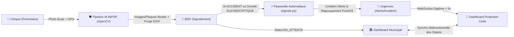

# 🏙️ SmartCity Insight AI — Guide de l'Architecture Unifiée & Soutenance

> **Fiche de Synthèse & Démonstration**  
> Plateforme Collaborative Unifiée : **Module Signalements & Municipalité** (Étudiant 2) & **Module Protection Civile & Urgences** (Étudiant 3).

---

## 1. 🔄 Flux Global de Données de A à Z



1. **Dépôt Citoyen** : Un citoyen signale un incident sur la voie publique (ex. collision de véhicules avec blessés) avec coordonnées GPS et photo via `CitizenReportForm.tsx`.
2. **Conformité Légale INPDP** : Le backend intercepte l'image, applique les cascades de Haar OpenCV pour flouter automatiquement les visages et plaques d'immatriculation, et purge les métadonnées EXIF sensibles avant stockage.
3. **Supervision Municipale** : Le signalement apparaît instantanément dans la file de pilotage du **Responsable Municipal** avec calcul d'un score de priorité IA (gravité + impact mobilité).
4. **Escalade d'Urgence Automatique (< 5s)** : Le signal `post_save` détecte la gravité/catégorie d'accident, génère l'entrée dans le module `urgences`, effectue le regroupement spatial PostGIS, associe l'alerte au signalement et diffuse l'événement en temps réel par WebSocket.
5. **Alerte Live Protection Civile** : L'écran de commandement des pompiers émet immédiatement l'alarme sonore d'urgence, affiche l'alerte sur la carte Google Maps, et calcule l'itinéraire optimal depuis la caserne la plus proche.

---

## 2. 🛠️ Stack Technique & Infrastructure

| Domaine | Technologies Utilisées | Rôle dans l'Architecture |
| :--- | :--- | :--- |
| **Backend Core** | Python 3.10+, Django 5.2, DRF 3.18 | API REST, logique métier, authentification RBAC |
| **Temps Réel & ASGI** | Django Channels 4.3, Daphne 4.2, InMemory / Redis 7 | Diffusion WebSockets d'urgence bi-directionnelle (< 5 secondes) |
| **Vision par Ordinateur IA** | OpenCV Headless, Pillow (PIL) | Détection automatique des visages/plaques & conformité légale INPDP |
| **Machine Learning Prédictif** | Scikit-learn, Pandas, NumPy | Modèle Random Forest prédisant l'indice de risque routier (*Risk Map*) |
| **Base de Données** | PostgreSQL 16 + PostGIS *(avec fallback transparent SQLite)* | Stockage relationnel et calculs spatiaux de proximité (rayon 150m) |
| **Simulateur de Trafic Autonome** | Python 3, FastAPI, Uvicorn, WebSockets (Port 8001) | Simulation temps réel du réseau routier du Grand Tunis (remplace Google Maps Traffic) |
| **Frontend & Cartographie** | React 19, TypeScript, Vite, Leaflet, Lucide | Interface réactive Glassmorphism sombre, polylines de trafic et routage secours |

---

## 3. 📊 Tableau Comparatif & Passerelle de Synchronisation

| Caractéristique | 🏛️ Module Signalements & Mairie (Étudiant 2) | 🚒 Module Protection Civile (Étudiant 3) |
| :--- | :--- | :--- |
| **Rôle Principal** | Gouvernance, maintenance urbaine & citoyenneté | Poste de commandement des secours & interventions |
| **Conformité & IA** | **INPDP** : Floutage OpenCV + suppression totale EXIF | **Risk Map** : Random Forest (trafic, météo, travaux) |
| **Sécurité d'Accès** | **RBAC** (`CITOYEN` vs `RESPONSABLE_MUNICIPAL`) | Identification agent pompier (matricule / badge) |
| **Anti-Abus & Quotas** | **Rate Limiting** strict (5 signalements max / heure / IP) | Filtrage par regroupement spatial (30 min / 150 m) |
| **Indicateurs Clés** | Taux de résolution, ratio INPDP, priorisation mobilité | Délais d'intervention, statut des casernes, alarmes |

### 🔗 Le Pont de Synchronisation Bidirectionnelle (`signalements/signals.py`)
* **Municipal ➔ Pompiers** : Si le Responsable Municipal passe un signalement lié à `EN_COURS` (respectivement `RESOLU`), l'`AlerteAccident` associée passe automatiquement à `PRISE_EN_CHARGE` (respectivement `CLOTURE`), avec horodatage strict et diffusion WebSocket.
* **Pompiers ➔ Municipal** : Dès qu'une unité de secours prend en charge l'intervention (`PRISE_EN_CHARGE` ou `EN_INTERVENTION`) ou clôture l'alerte (`CLOTURE`), le signalement municipal correspondant est automatiquement synchronisé vers `EN_COURS` ou `RESOLU`.
* **Anti-boucle récursive** : Protégé par le contexte thread-local `_SyncContext`.

---

## 4. 📁 Rôle des Fichiers Clés

### Backend (`signalements/` & `urgences/`)
* [`signalements/models.py`](file:///c:/3%20eme/smartcity_insight_ai-/signalement/signalements/models.py) : Modèle `Signalement` avec auto-anonymisation INPDP au `save()`, profils RBAC et champ `alerte_liee`.
* [`signalements/signals.py`](file:///c:/3%20eme/smartcity_insight_ai-/signalement/signalements/signals.py) : Moteur d'escalade d'urgence et synchronisation bidirectionnelle automatique des statuts.
* [`signalements/privacy_blur.py`](file:///c:/3%20eme/smartcity_insight_ai-/signalement/signalements/privacy_blur.py) : Moteur de vision OpenCV (cascades de Haar) pour floutage gaussien et purge EXIF.
* [`urgences/models.py`](file:///c:/3%20eme/smartcity_insight_ai-/signalement/urgences/models.py) : Modèles `SignalementAccident`, `AlerteAccident` (avec horodatages stricts) et `JournalAudit`.
* [`urgences/services.py`](file:///c:/3%20eme/smartcity_insight_ai-/signalement/urgences/services.py) : Algorithme de regroupement spatial (150m) et diffusion asynchrone non-bloquante WebSocket.
* [`urgences/ml_models.py`](file:///c:/3%20eme/smartcity_insight_ai-/signalement/urgences/ml_models.py) : Modèle Random Forest calculant le risque d'accident (faible, moyen, élevé) et ses causes.
* [`config/asgi.py`](file:///c:/3%20eme/smartcity_insight_ai-/signalement/config/asgi.py) : Routeur protocolaire ASGI aiguillant HTTP vers Django et WebSocket vers `ProtectionCivileConsumer`.

### Frontend (`frontend/src/`)
* [`App.tsx`](file:///c:/3%20eme/smartcity_insight_ai-/signalement/frontend/src/App.tsx) : Aiguillage étanche : portail unifié si non connecté, ou navigation isolée par rôle une fois connecté.
* [`components/UnifiedAuthPortal.tsx`](file:///c:/3%20eme/smartcity_insight_ai-/signalement/frontend/src/components/UnifiedAuthPortal.tsx) : Point d'accès unique Glassmorphism orienté rôles (`CITOYEN`, `RESPONSABLE_MUNICIPAL`, `PROTECTION_CIVILE`).
* [`components/CitizenReportForm.tsx`](file:///c:/3%20eme/smartcity_insight_ai-/signalement/frontend/src/components/CitizenReportForm.tsx) : Formulaire géolocalisé avec téléversement photo, gestion du Rate Limit et accusé d'escalade pompier.
* [`components/MunicipalDashboard.tsx`](file:///c:/3%20eme/smartcity_insight_ai-/signalement/frontend/src/components/MunicipalDashboard.tsx) : Dashboard décisionnel, priorisation IA selon la mobilité, badge pompier et statistiques INPDP.
* [`pages/ProtectionCivilePage.tsx`](file:///c:/3%20eme/smartcity_insight_ai-/signalement/frontend/src/pages/ProtectionCivilePage.tsx) : Poste de commandement : écoute WebSocket (< 5s), carte Google Maps, alarme sonore et calcul d'itinéraires casernes.

---

## 5. 🚀 Commandes de Lancement & Scénario de Démo (2 min)

### Commandes Rapides

```powershell
# 1. Lancement du Backend Daphne / Channels (Port 8000)
.\run_backend.bat

# 2. Lancement du Frontend Vite React (Port 5173)
cd frontend
npm run dev

# 3. Exécution des tests unitaires complets (15/15 OK)
python manage.py test signalements
```

---

### ⏱️ Scénario de Démonstration Live devant le Jury (2 minutes chrono)

| Temps | Action & Écran | Ce qu'il faut expliquer au Jury |
| :---: | :--- | :--- |
| **00:00 - 00:20** | Ouvrir deux fenêtres de navigateur côte à côte sur `http://localhost:5173` :<br>• Fenêtre 1 : Se connecter en **Protection Civile**.<br>• Fenêtre 2 : Se connecter en **Citoyen**. | *"Nous avons un portail unifié. À gauche, le poste opérationnel de la Protection Civile connecté en WebSocket temps réel. À droite, l'espace public citoyen."* |
| **00:20 - 00:50** | Sur la fenêtre **Citoyen** :<br>• Choisir catégorie **Accident** et gravité **Critique**.<br>• Joindre une photo contenant un visage ou une voiture.<br>• Valider le formulaire. | *"Le citoyen soumet l'alerte. Le backend Django déclenche instantanément le pipeline OpenCV : l'image est anonymisée conformément aux exigences de l'INPDP (visages et plaques floutés, EXIF purgés)."* |
| **00:50 - 01:20** | Regarder la fenêtre **Protection Civile** :<br>• La sirène retentit immédiatement (< 5s).<br>• L'alerte apparaît en tête de liste et sur la carte.<br>• Cliquer sur l'alerte : l'itinéraire caserne s'affiche. | *"Sans aucun rechargement de page, l'alerte critique a été transmise en moins de 5 secondes par Django Channels. La caserne la plus proche est mobilisée et l'itinéraire d'urgence est calculé."* |
| **01:20 - 02:00** | Dans la fenêtre Citoyen, se déconnecter et se connecter en **Responsable Municipal** :<br>• Constater le badge `🔥 Protection Civile` sur l'incident.<br>• Passer le statut à **En cours** ou **Résolu**.<br>• Vérifier que le statut bascule en direct chez les pompiers. | *"Voici la synchronisation bidirectionnelle : le tableau de bord municipal supervise l'incident et coordonne la résolution avec les secours en temps réel."* |
